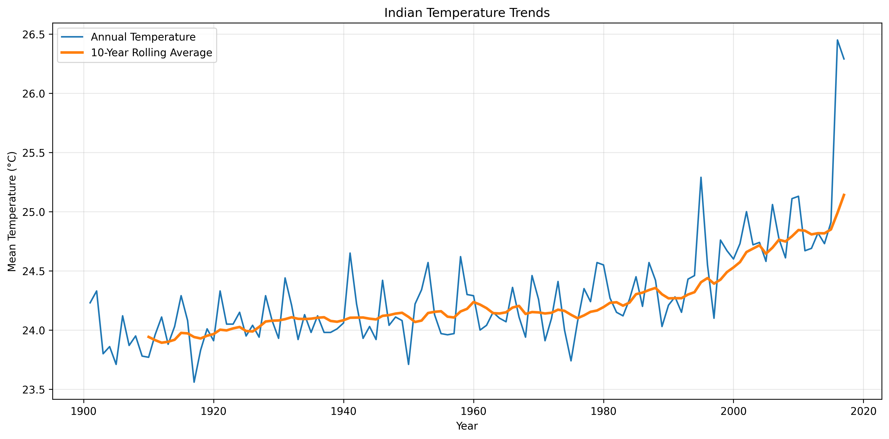
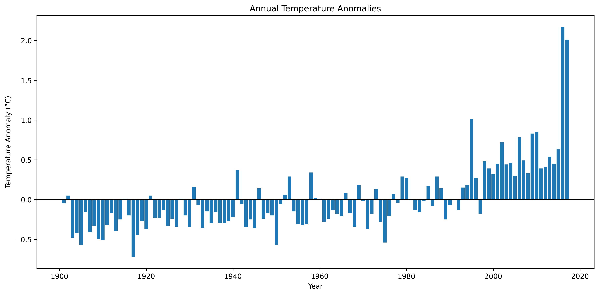

# Indian Climate & Temperature Anomaly Analysis

## Overview
This project analyzes historical mean temperature data for India to explore long-term temperature trends and annual variations.

## Objectives
- Analyze a 50-year period of historical temperature data.
- Calculate temperature anomalies.
- Calculate a 10-year rolling average.
- Identify the five years with the most extreme anomalies.
- Visualize trends using line and bar charts.

## Tools Used
- Python
- Pandas
- NumPy
- Matplotlib
- Google Colab / Jupyter Notebook

## Methodology
1. Loaded and cleaned the historical dataset.
2. Selected the analysis period.
3. Calculated the reference average and annual temperature anomalies.
4. Computed the 10-year rolling average.
5. Identified extreme anomalies and created visualizations.

## Dataset
Source: India Meteorological Department (IMD), via the Government of India's Open Government Data platform.

## Results

### Visualizations

**1. Indian Temperature Trends**

This chart compares annual mean temperatures with the 10-year rolling average.

**2. Annual Temperature Anomalies**

This chart shows the difference between each year's mean temperature and the average for the selected study period.

## How to Run
Open `Indian_Climate_Analysis.ipynb` in Google Colab and run the cells in order.

## Disclaimer
This is an educational data analysis project. Findings depend on the source dataset, selected time period and reference baseline.
